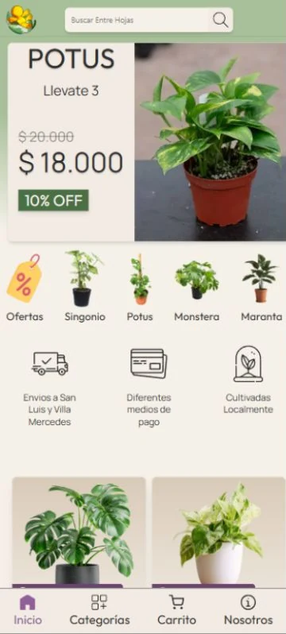
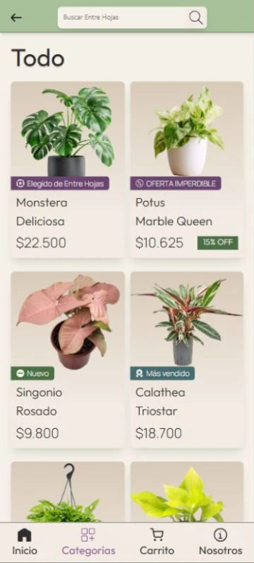
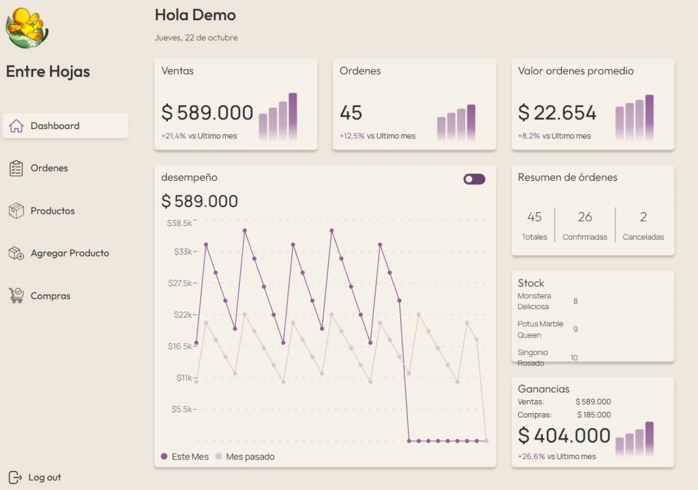
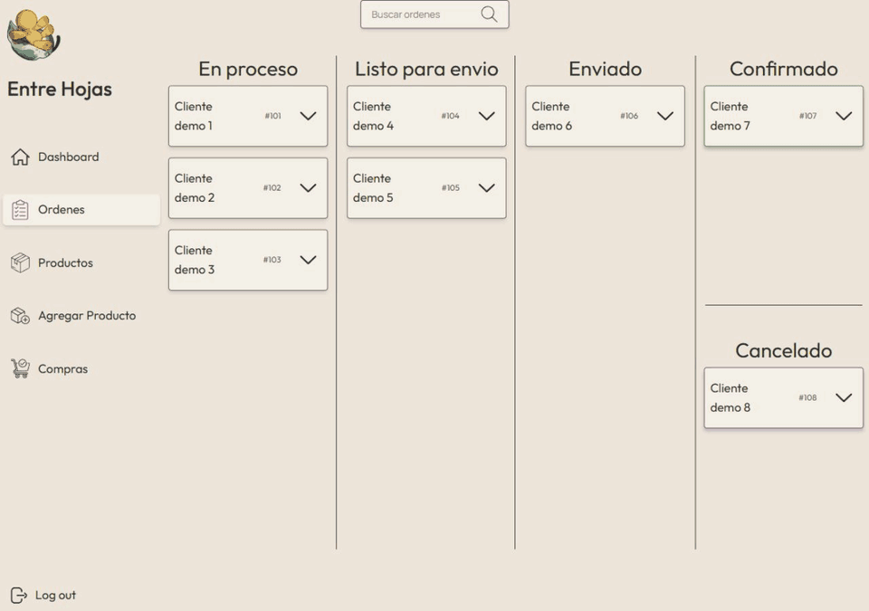

<p align="center">
  
</p>

# Entre Hojas

Una aplicación para acompañar el día a día de un vivero de plantas de interior: del catálogo y los pedidos de los clientes a la gestión de productos, inventario, compras y órdenes.

**Estado:** en desarrollo. El sitio público está pensado principalmente para celular y el panel administrativo para escritorio.

<p align="center">
  
  
</p>

> Capturas de la interfaz real con datos de demostración. Los nombres, pedidos e importes del panel son ficticios. [Cómo renovar las capturas](docs/capturas.md).

## Qué podés hacer

| Sitio público | Panel administrativo |
| --- | --- |
| Explorar plantas por categoría y buscar por nombre. | Crear y editar productos, imágenes, descuentos y etiquetas. |
| Consultar fotos, precio y características de cada planta. | Administrar disponibilidad y agregar stock. |
| Armar un carrito y registrar un pedido con dirección y medio de pago. | Organizar órdenes en un tablero con arrastrar y soltar. |
| Consultar el detalle del pedido generado. | Consultar indicadores de ventas, órdenes y compras registradas. |
| Guardar carrito y ubicación en el navegador. | Consultar ventas, compras, stock y estadísticas mensuales. |

El checkout registra el medio de pago elegido; actualmente no procesa ni verifica cobros mediante una pasarela.

El formulario y la gestión de compras están en desarrollo en `fayan`. Esta rama incorpora documentación; no incorpora esa implementación. Las secciones de compras describen el diseño previsto y están identificadas como tales.

## Vista previa

### Dashboard



### Gestión de órdenes

El tablero organiza los pedidos por estado y permite consultar el detalle de cada tarjeta.



## Tecnologías

React · TypeScript · Vite · Tailwind CSS · React Router · Express · MySQL · pnpm

Los gráficos usan Recharts y el tablero de órdenes usa dnd-kit.

```text
Entre-Hojas/
├── client/       # Sitio público y panel administrativo
├── api/          # API Express, consultas MySQL y migraciones
└── docs/         # Guías, reglas del negocio y capturas
```

## Empezar

### Ver la interfaz con datos de demostración

Con Node.js y pnpm instalados, desde la raíz:

```sh
pnpm --dir client install
node docs/preview.mjs
```

Abrí [la vista local](http://127.0.0.1:4173) o [el panel de demostración](http://127.0.0.1:4173/admin). Usa la interfaz del proyecto con datos ficticios en memoria y no necesita MySQL. Sirve para explorar catálogo, dashboard y órdenes; no implementa todos los formularios ni el checkout. Los cambios de estado se pierden al reiniciarla.

### Desarrollar con la API y MySQL

Necesitás una base con el esquema existente del proyecto. **El repositorio todavía no incluye un SQL de instalación completo**: las migraciones disponibles amplían tablas existentes. Pedí al equipo una exportación del esquema sin datos personales y seguí la [guía de desarrollo](docs/desarrollo.md).

Una vez preparada la base, los archivos `.env`, las migraciones y el usuario administrador:

```sh
pnpm install
pnpm --dir api install
pnpm --dir client install
pnpm dev
```

El cliente abre en [localhost:5173](http://localhost:5173). Configurá `PORT=3000` en la API para usar el proxy de desarrollo. Las plantillas de configuración están en [api/.env.example](api/.env.example) y [client/.env.example](client/.env.example).

## Documentación

| Guía | Contenido |
| --- | --- |
| [Índice](docs/README.md) | Por dónde empezar según la tarea. |
| [Desarrollo local](docs/desarrollo.md) | Instalación, configuración, migraciones, administrador, pruebas y acceso desde el celular. |
| [API](docs/api.md) | Capas del backend, sesión, endpoints y ejemplos. |
| [Frontend](docs/frontend.md) | Pantallas, contextos, imágenes y comunicación con la API. |
| [Reglas de negocio](docs/reglas-de-negocio.md) | Stock, órdenes, compras, disponibilidad y cierres mensuales. |
| [Despliegue](docs/despliegue.md) | Compilación, configuración, almacenamiento y respaldos. |
| [Capturas y GIF](docs/capturas.md) | Datos de demostración y mantenimiento de los recursos visuales. |

## Pendientes conocidos

- Incorporar un esquema SQL inicial para poder instalar desde una base vacía.
- Integrar la gestión de compras que se está desarrollando por separado.
- Definir si cancelar una orden debe reintegrar stock: actualmente cambiar el estado no lo hace.
- Completar la preparación y documentación del entorno de producción elegido.

## Equipo

Desarrollado por **Fabián Barzola** y **Marcos Coloma**.
